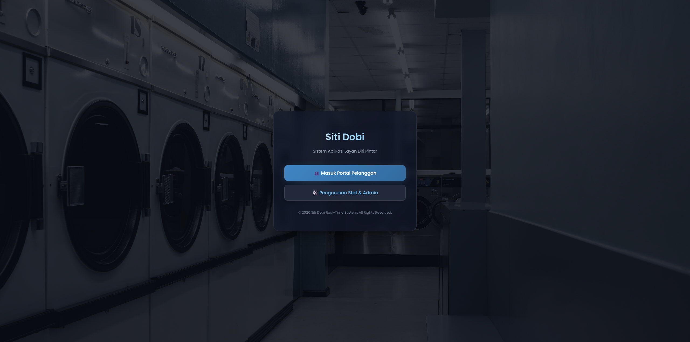
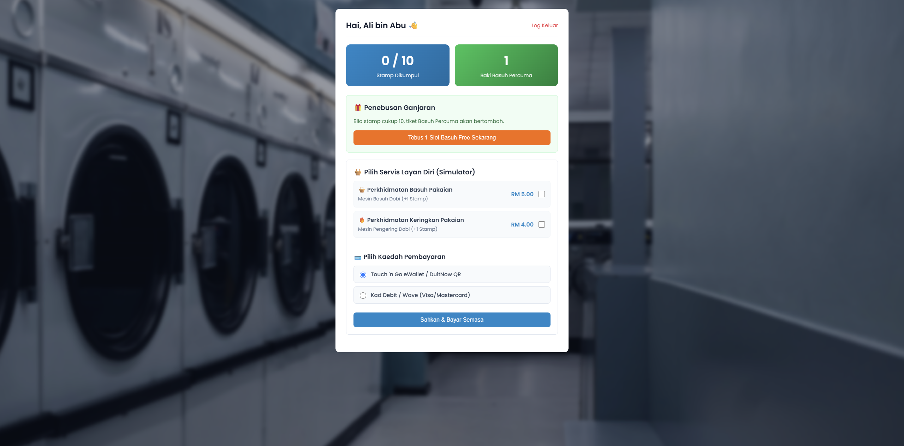
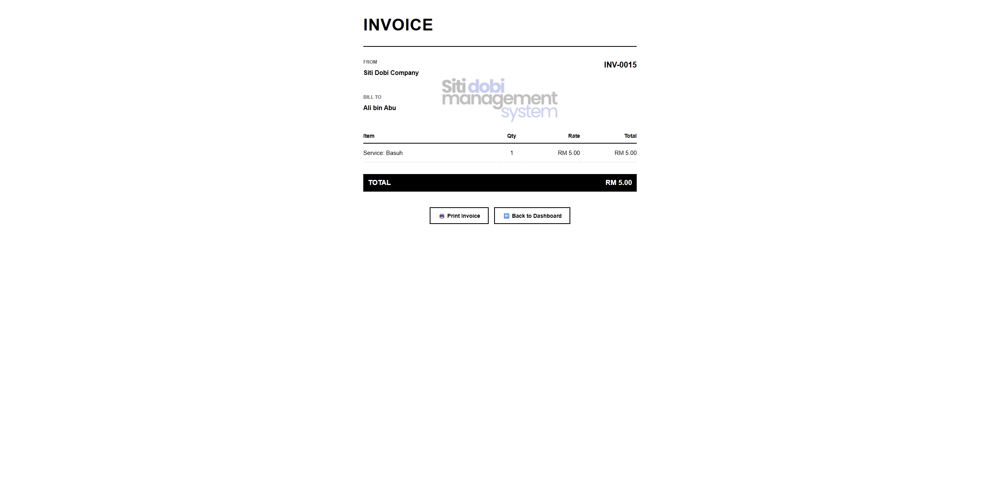
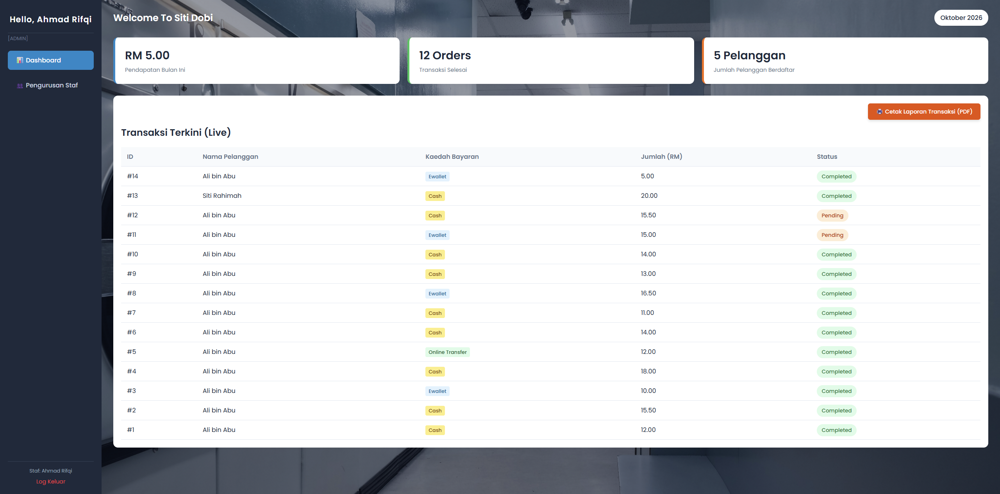
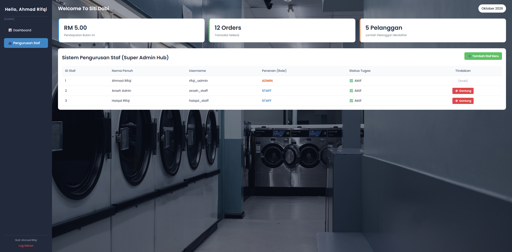

# Siti Dobi — Laundry Loyalty & Management System

A web-based self-service laundry system with a digital loyalty card. Customers pay for wash/dry services and collect stamps; every 10 stamps earns a free wash. Staff and admins track sales and transactions and manage staff accounts from a dashboard.

Built with **PHP**, **MySQL/MariaDB**, HTML and CSS.



## Features

**Customer portal**
- Register and log in with a phone number
- Choose wash/dry services and pay by e-wallet or debit card (simulated)
- Loyalty card: 1 stamp per completed service, a free wash every 10 stamps
- Redeem free washes
- Printable invoice for each payment

**Staff & admin portal**
- Live dashboard: this month's revenue, completed orders, and registered customers
- Transaction table with payment method and status, printable as PDF
- Role-based access: only admins can manage staff
- Admins can create staff accounts and suspend or reactivate them

## Screenshots

| Customer dashboard | Invoice |
|---|---|
|  |  |

| Staff dashboard | Staff management (admin only) |
|---|---|
|  |  |

## Database design

Five tables: `customer`, `loyalty_card`, `transaction`, `reward_redemption` and `staff`.

Most of the loyalty logic runs in the database, using MySQL triggers:
- `trg_create_loyalty_card` creates a loyalty card automatically when a customer registers.
- `trg_add_stamp_on_update` adds a stamp when a transaction changes to `completed`. On the 10th stamp it resets the count, adds a free wash, and records a pending reward.

Foreign keys keep the data consistent. For example, a staff member who has transactions can't be deleted, so the app suspends the account (`is_active = 0`) instead, which also keeps the sales history intact.

## Security

- **Prepared statements** on every query that takes user input, to prevent SQL injection
- **Passwords hashed with bcrypt** (`password_hash` / `password_verify`), never stored as plain text
- **Session-based access control** on every protected page, with the session ID regenerated at login
- **Role checks**: only a logged-in admin can create staff accounts
- **Server-side input validation**: prices and payment methods come from whitelists, not from form values
- **Atomic reward redemption**: redeeming a free wash runs in a database transaction, so a failure can never deduct a reward without recording it
- Customers can only view their own invoices

## Running it locally

1. Install [XAMPP](https://www.apachefriends.org/) and start **MySQL**.
2. In phpMyAdmin (`http://localhost/phpmyadmin`), create a database named `siti_dobi_db` and import `siti_dobi_db.sql`.
3. From the project folder, run:
   ```
   C:\xampp\php\php.exe -S localhost:8000
   ```
4. Open `http://localhost:8000/welcome.php`.

The app connects as MySQL `root` with no password (the XAMPP default). Change the connection details at the top of each PHP file if your setup is different.

### Demo accounts

| Role | Login | Password |
|---|---|---|
| Admin | `rifqi_admin` | `admin123` |
| Staff | `arash_staff` | `admin123` |
| Customer | `0111234567` (phone) | `customer123` |

These are sample accounts for local testing only.

## Project structure

```
welcome.php              Landing page (choose customer or staff portal)
customer_login.php       Customer login (phone + password)
customer_register.php    Customer sign-up
customer_dashboard.php   Loyalty card, service payment, reward redemption
invoice.php              Printable invoice for the latest payment
staff_login.php          Staff/admin login
index.php                Staff dashboard and admin staff management
staff_register.php       Create staff account (admin only)
tambah_transaksi.php     Record a counter transaction (staff only)
about_us.php             About page
siti_dobi_db.sql         Database schema, triggers and sample data
```

## Possible improvements

- Move the database connection into one shared config file
- CSRF tokens on state-changing actions
- Password change and reset
- Customer transaction history and monthly sales reports

## Team

Built as a group project for the Database course at Universiti Tun Hussein Onn Malaysia (UTHM).

- Uthman 'Affan
- Rifqi Adam
- Haikal Rifqi
- Fikri Azman
- Arash Adnin

After the course, I audited the code and fixed several security issues: SQL injection, a hard-coded backdoor password, open admin registration and plain-text passwords (see Security above).

## Author

**Uthman 'Affan**, Bachelor of Computer Science (Multimedia Computing), UTHM

[LinkedIn](https://www.linkedin.com/in/uthman-affan)
